<h1 align="center">Lifeline</h1>
<p align="center"><b>The supply chain between worlds.</b><br>
Agents that forecast danger on Mars and move air, water and food between colonies, and from Earth, before anyone runs out.</p>

<p align="center">
  <a href="https://lifeline-alpha-gray.vercel.app/"><b>Live demo</b></a> ·
  <a href="https://ahmedd-ben-salah.github.io/lifeline/deck/"><b>Pitch deck</b></a> ·
  <a href="https://ahmedd-ben-salah.github.io/lifeline/explainer/explainer.html">Technical explainer</a> ·
  <a href="docs/Lifeline_Explainer.pdf">Explainer (PDF)</a>.
  <a href="https://youtu.be/O_zGMuz0ozQ">Demo Video</a>
</p>

<p align="center"><i>IEEE Lumen 2.0 · Beyond 2030 challenge</i></p>

<p align="center">
  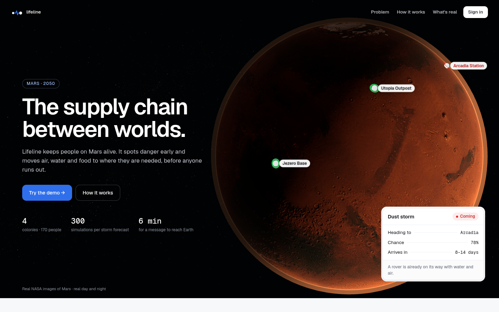
</p>

---

## The future we see

By **2050**, several crewed settlements share Mars: Jezero Base, Arcadia Station, Utopia Outpost and Valles Hub. Each one makes its own oxygen and water, grows part of its food, and lives on solar and fission power.

Two facts collide:

- **Rockets can only leave Earth for Mars about every 26 months**, and the trip takes 6 to 9 months. Anything a colony needs from Earth has to be ordered up to two years before it is needed.
- **Dust storms can cut solar power within days.** In June 2018 the Opportunity rover went from about 645 Wh to 22 Wh per sol at a dust optical depth near 10.8, and never woke up again. Planet-wide storms began in 3 of the last 14 Mars years.

On Earth a late delivery is annoying. On Mars it is fatal.

## The problem

| What goes wrong | Why today's methods fail |
|---|---|
| One colony sees danger, the others don't | Every base monitors itself. Nobody fuses all sensors into one forecast. |
| Earth can't react in time | Launch windows every 26 months and 6 to 9 month transits. Ordering after the problem is too late. |
| Human coordination is slow | A question to Earth takes 8 to 48 minutes round trip, and solar conjunction cuts the link for about two weeks. |
| Local delivery breaks | When a rover fails or a route is unsafe, nothing re-plans the delivery automatically. |

## Who it is for

| User | What they get |
|---|---|
| **Colony operators** (main users) | One screen with days of air, water and food left, the storm forecast, agent messages, rover deliveries |
| **Earth mission control** | The Earth order, already sized, packed and timed to the launch window, waiting for their approval |
| **Launch and cargo suppliers** | Confirmed manifests per rocket |
| **Viewers** | Read-only access |

## What Lifeline does

1. **Forecast**: a weather service for Mars at three horizons. *Outlook* (season risk ~18 months ahead, which is the lead time an Earth order needs), *Watch* (a disturbance likely to grow), and *Track* (a 300-run ensemble drawn as a hurricane-style cone with arrival times per colony).
2. **Coordinate**: one agent per colony plus weather, logistics and Earth-supply agents. They warn each other, ask for help, offer only what keeps their own reserve safe, and act alone when a colony goes silent, inside limits set by a published policy.
3. **Deliver**: rover convoys routed over real Mars terrain and re-routed when a rover breaks down, then an Earth order with launch date, real transfer trajectory, packed rockets and a scored landing site. It is sent only after two people approve it, over a light-delayed link.

**Golden rule: the math decides, the agents explain.** Every number on screen comes from a deterministic engine function. The language model only turns those numbers into plain words, and code rejects any reply that contains a number not found in the tool results.

## Live demo

**https://lifeline-alpha-gray.vercel.app/**

| Account | Role | Can |
|---|---|---|
| `ayari@jezero.base` | Admin, Jezero ops officer | Everything, plus demo controls (press **D**) |
| `lina@utopia.base` | Operator, Utopia | Ask agents, accept offers, create transfers, approve orders |
| `control@earth.gov` | Earth mission control | Approve and confirm Earth orders, after the light delay |
| `supply@cargo.co` | Supplier | Resupply page only, confirm manufacturing |
| `jury@lumen.org` | Viewer | Read-only |

Password for every demo account: `lifeline-demo`

### The story in two minutes

Scenario: **12 November 2050**, Mars season Ls 292° (peak dust season). Dust storm **S-17** is forming over the Hellas basin.

1. **Overview**: lowest reserve is Arcadia with 19 days of air. Storm S-17 has a 78% chance to reach Arcadia in 8 to 14 days.
2. **Forecasts**: the cone from 300 seeded simulations on real Mars terrain, with the evidence behind it.
3. **Comms**: the agents respond.
   - **WARN**: the storm is coming.
   - **NEED**: Arcadia is short 4,240 kg of water and 1,370 kg of air.
   - **TIMEOUT**: Arcadia's antenna is down, so Jezero acts for it after 20 minutes, as the policy allows.
   - **OFFER**: Utopia sends 1,550 kg of water and 540 kg of air and keeps 90 days for itself.
   - **ACCEPT**, then **FAULT**: rover 3 breaks down, and rover 7 is re-routed to pick up its cargo. It arrives in 7.9 days, just before the storm.
   - **ORDER**: 261 t in 3 rockets for the next launch window.
4. **Resupply**: approve the Earth order. The approval travels to Earth with the real light delay. Earth control approves, and the order is sent.
5. **Traffic 3D**: real planet positions, the cargo fleet on its transfer trajectory, rovers and the storm on Mars.

Ask the agents anything in Comms, for example *"What if the storm lasts 60 sols?"*. The answer is computed by the engine and shows which tools were used.

## Screenshots

### Space view: the real solar system in 3D

Earth and Mars at their true positions for the scenario date, the cargo fleet on its Lambert transfer trajectory, Earth with real day/night and clouds, Mars with the four colonies. Time can run at 1 hour, 1 day or 10 days per second, and the view can jump to the launch or the arrival.

<table>
  <tr>
    <td width="50%">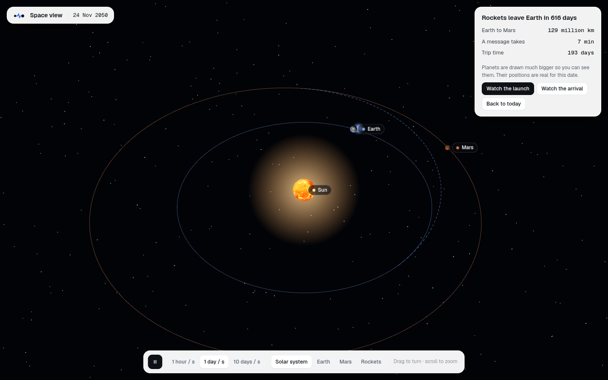<br><sub><b>Solar system</b>: true orbits, countdown to the next launch window</sub></td>
    <td width="50%">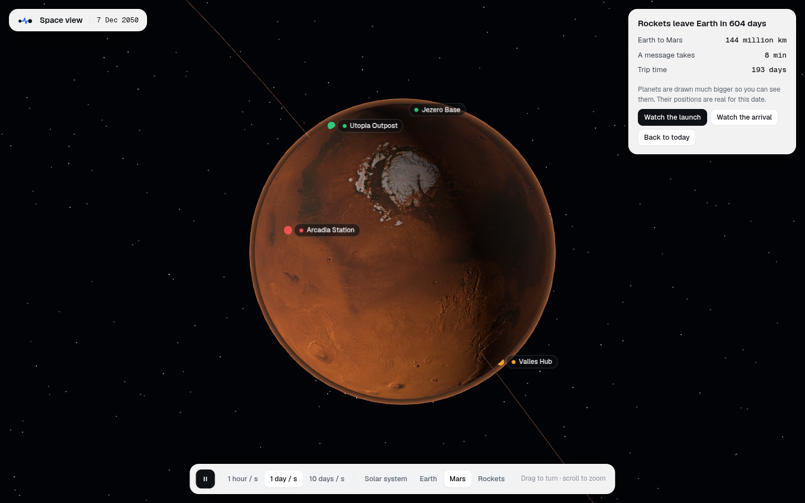<br><sub><b>Mars</b>: Jezero, Arcadia, Utopia and Valles on NASA imagery</sub></td>
  </tr>
  <tr>
    <td width="50%">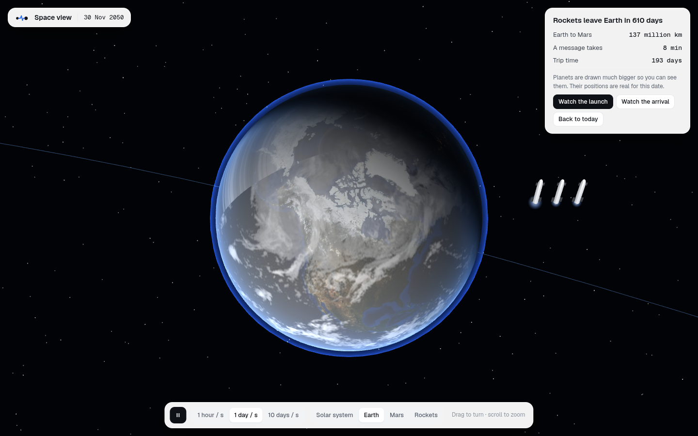<br><sub><b>Earth</b>: the cargo fleet waiting for the window</sub></td>
    <td width="50%">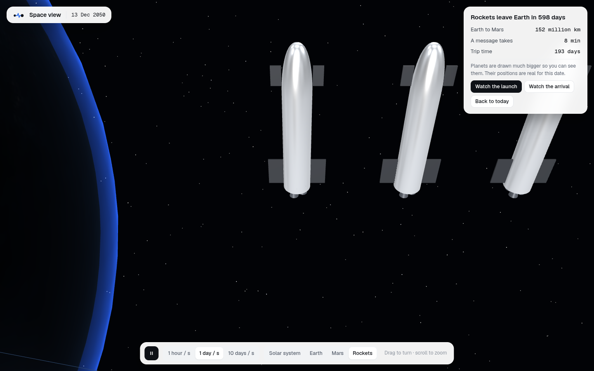<br><sub><b>Rockets</b>: three 100 t landers carrying the Earth order</sub></td>
  </tr>
</table>

### Mission control

<table>
  <tr>
    <td width="50%">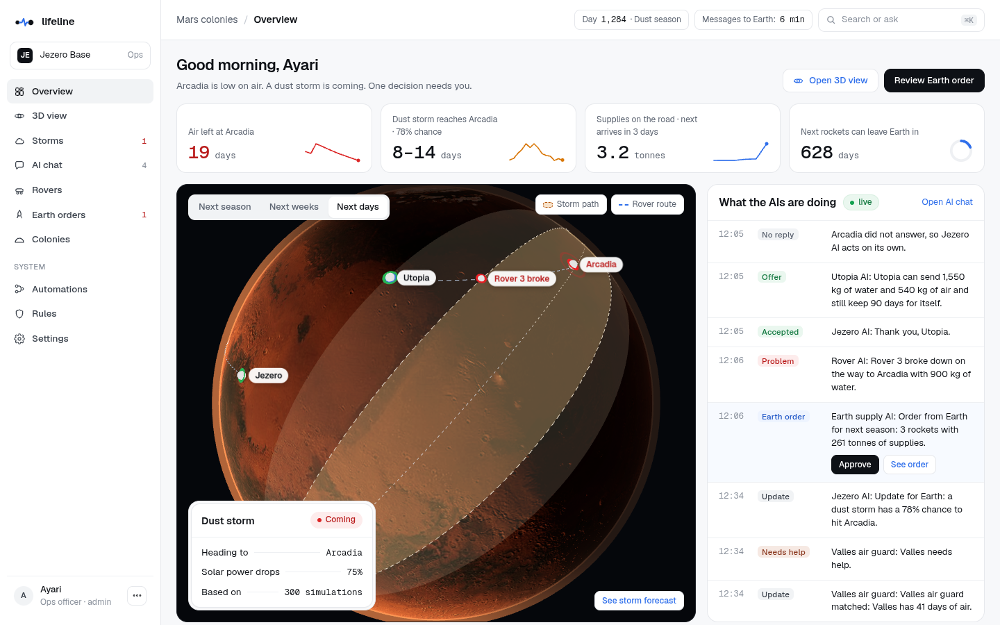<br><sub><b>Overview</b>: days of air left, the storm, cargo on the road, the next launch window, and what the agents are doing</sub></td>
    <td width="50%">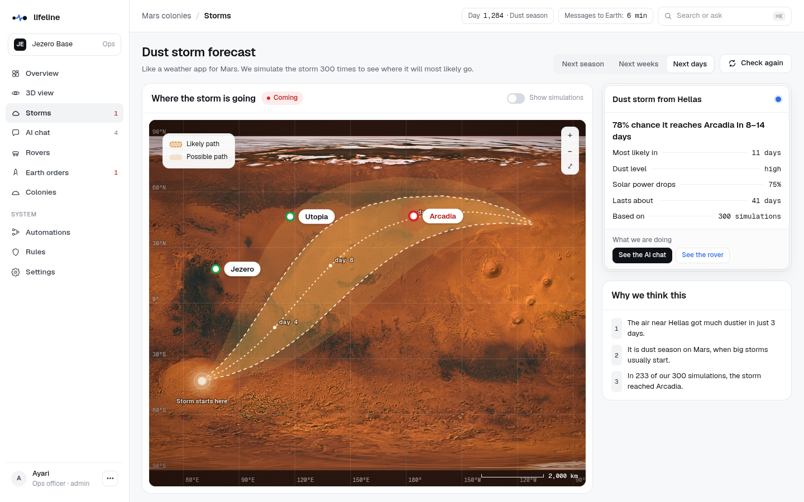<br><sub><b>Storm forecast</b>: the cone from 300 simulations, 78% chance to reach Arcadia in 8 to 14 days, and why</sub></td>
  </tr>
  <tr>
    <td width="50%">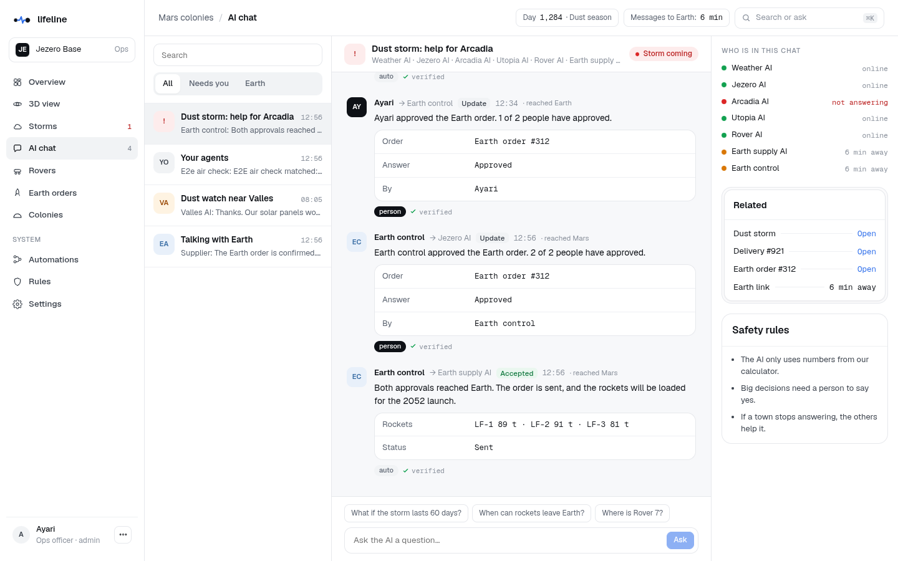<br><sub><b>Comms</b>: signed agent messages, light-delayed Earth replies, and questions answered with engine tools</sub></td>
    <td width="50%">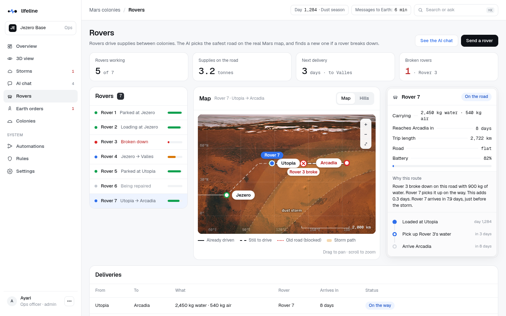<br><sub><b>Rovers</b>: A* routes on real Mars terrain, rover 3 broken down, rover 7 re-routed to recover its cargo</sub></td>
  </tr>
  <tr>
    <td width="50%">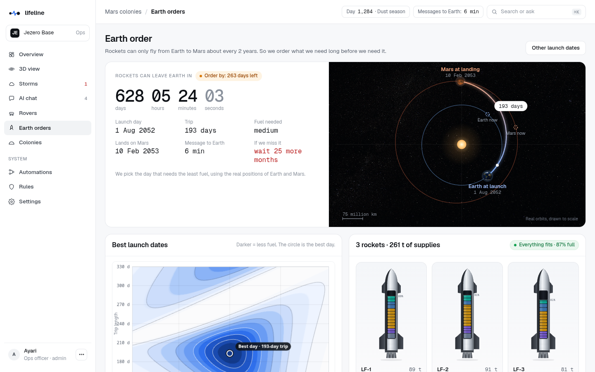<br><sub><b>Earth order</b>: countdown to launch, transfer orbit, best launch dates chart, and the cargo packed into three rockets</sub></td>
    <td width="50%">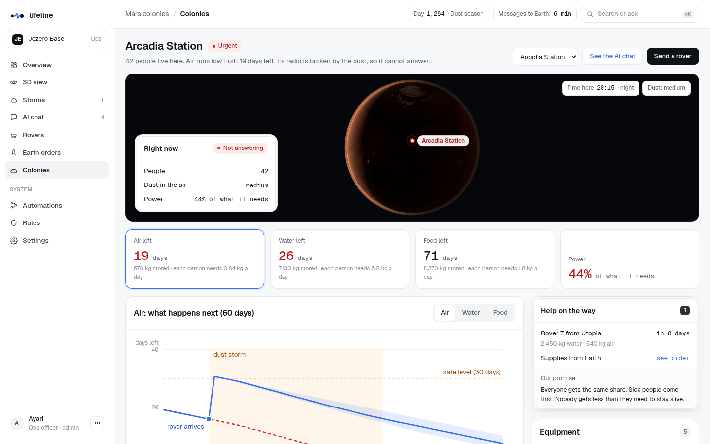<br><sub><b>Colony</b>: Arcadia's air, water, food and power, with the 60-day forecast through the storm</sub></td>
  </tr>
  <tr>
    <td width="50%">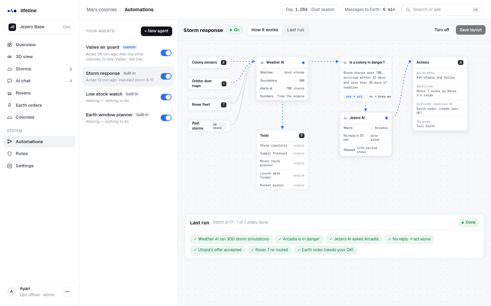<br><sub><b>Automations</b>: how the storm response works, step by step, and an agent builder for custom rules</sub></td>
    <td width="50%">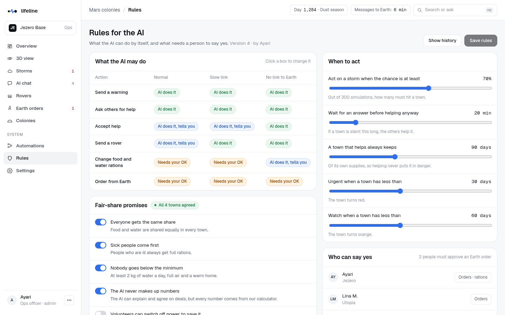<br><sub><b>Rules</b>: what the agents may do alone, what they report, and what needs a person's OK</sub></td>
  </tr>
</table>

<p align="center">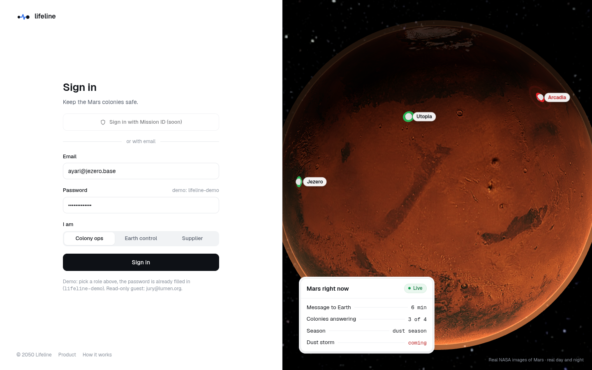<br><sub>Sign in with one of five roles: colony operator, Earth control, supplier, admin or viewer</sub></p>

## System design

### 1 · Architecture: agents on top, real tools underneath

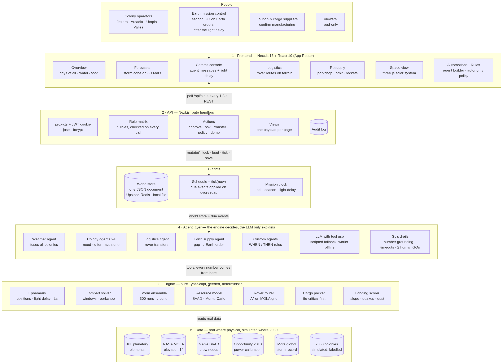

### 2 · Sequence: from a dust signal to a rocket on its way

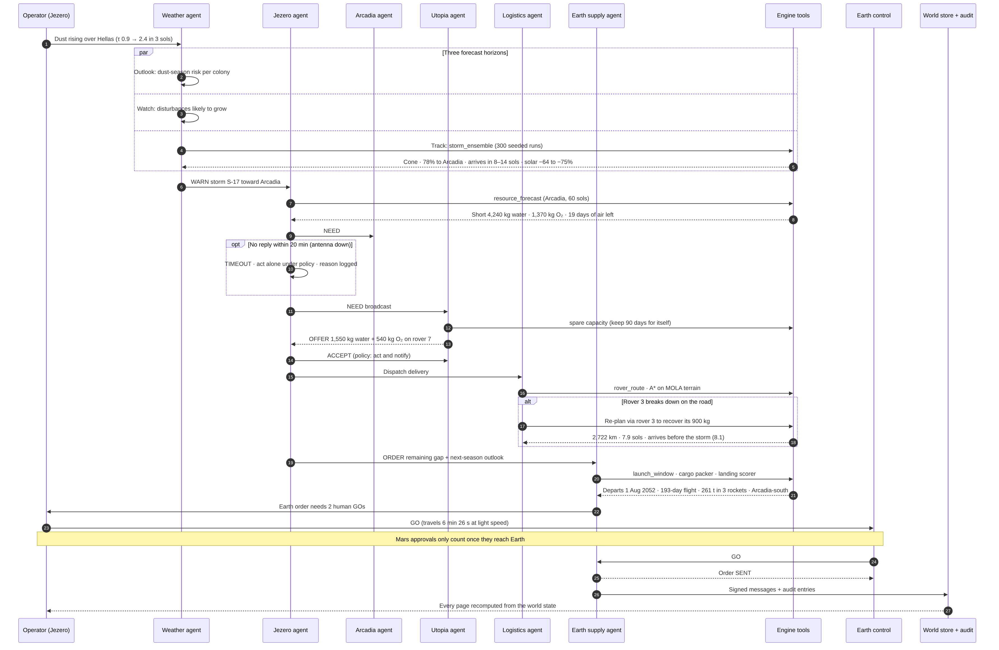

### 3 · Decision pipeline

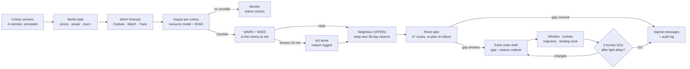

Diagram sources (Mermaid): [`docs/system-design/`](docs/system-design/).

- **One request, end to end**: `proxy.ts` guards pages. Every API route goes through `route()` in `lib/server/http.ts`, which verifies the session, checks the role permission and maps errors to status codes. Writes go through `mutate()` in `lib/server/store.ts`: lock, load, apply due events, change, save.
- **Time without a background worker**: future events (the reply timeout, a rover failure, a light-delayed message) are stored in `world.schedule` with a timestamp. `tick(now)` applies the ones that are due on every read, so the app runs on serverless with no cron or queue.
- **Light delay**: each message has a creation time and a delivery time. Messages crossing the Earth–Mars link are hidden from the other side until they arrive, and an approval from Mars only counts once it has physically reached Earth.
- **Nothing derived is stored**: reserve days, forecasts, routes and launch windows are recomputed from the world by the engine on each request, with caches for the expensive parts (ensemble, launch window, porkchop grid).

### Engine (`lib/engine`)

| Module | Method | Real reference |
|---|---|---|
| `ephemeris.ts` | Keplerian elements solved with Newton's method: planet positions, light delay, conjunction, Mars season Ls, Mars Sol Date, day/night terminator | JPL *Approximate Positions of the Planets*; Allison & McEwen 2000 |
| `lambert.ts` | Universal-variable Lambert solver (bisection), launch energy C3, porkchop grid, RK4 trajectory | Curtis, *Orbital Mechanics for Engineering Students* |
| `windows.ts` | Coarse then fine C3 scan for the next Earth→Mars window | Synodic period ≈ 780 days |
| `storm.ts` | 300-run seeded ensemble (bearing, speed, lifetime, growth), 67% / 90% cone, per-colony arrival P10/P50/P90; solar factor `exp(−0.313·(τ−0.5))` | Opportunity, June 2018 |
| `resources.ts` | Reserve days, Monte-Carlo 60-sol stock forecast, power allocation with oxygen first | NASA BVAD crew needs |
| `router.ts` | A* on a 1°×1° elevation grid with slope, storm-cone and blocked-zone costs, Chaikin smoothing | NASA MOLA |
| `packer.ts` | Life-critical cargo first, placed in the least-loaded rocket so no single loss takes all the oxygen | 100 t cargo lander (assumption) |
| `landing.ts` | Weighted score on slope, quake risk, distance and dust | — |
| `season.ts` | Seasonal storm activity and per-latitude risk; watch probability | Mars global storm record |

All randomness is seeded (`rng.ts`, mulberry32), so the same inputs always give the same forecast.

### Agents (`lib/agents`)

- **Protocol**: `WARN · NEED · OFFER · ACCEPT · TIMEOUT · ORDER · FAULT · INFO · ASK · ANSWER`, validated with zod and signed with HMAC-SHA256.
- **Roles**: weather, colony (×4), logistics and Earth supply agents. Colonies only offer what keeps their own 90-day reserve.
- **Tools** (`tools.ts`): `network_status`, `storm_ensemble`, `resource_forecast` (with what-if overrides), `rover_route`, `fleet_status`, `launch_window`, `light_delay`, `season_outlook`. Each one wraps an engine function.
- **Guardrails** (`llm.ts`):
  - number grounding: any number not found in the tool results means the reply is rejected and rewritten once, then the scripted wording is used;
  - timeouts on every call;
  - a scripted fallback over the same facts, so the product works with no network;
  - agents cannot approve Earth orders or change rations.
- **Autonomy policy** (Policies page): every action is *automatic*, *automatic with notification*, or *needs a human Go*, with separate settings for normal operation, high delay and blackout.
- **Agent builder** (Automations page): operators create their own WHEN / THEN rules ("when Valles has less than 45 days of air, ask the others for help"). Rules are deterministic, checked once a minute, and can require an OK before acting.

### Security

- Passwords hashed with bcrypt. Sessions are HS256 JWTs in an httpOnly cookie.
- Five roles with a permission matrix enforced on the server for every API call. The UI also hides what a role cannot do.
- Earth orders need two different people, and Mars approvals only count after the light delay.
- Every human and agent action is written to an audit log. Agent messages carry a signature.
- The language-model API key is read on the server only and never sent to the browser.

## Tech stack

| Piece | Choice | Why it belongs |
|---|---|---|
| App | Next.js 16, React 19, TypeScript | Frontend and API in one codebase, one deploy |
| 3D | three.js with NASA textures | Mars globe with real lighting, storm cone and routes; Earth–Mars orbit view |
| Agents | LLM with tool use (Anthropic Messages API) | Plain-language messages and questions grounded in engine tools |
| Validation | zod | Message and request schemas |
| Auth | jose, bcryptjs | Stateless sessions that work on serverless |
| State | Upstash Redis or local file | Shared world across serverless instances |
| Tests | vitest | Engine checked against real reference values |
| Hosting | Vercel | One-command deploy |

## Run it locally

```bash
npm install
cp .env.example .env.local
npm run dev
```

Open http://localhost:3000. Set `AUTH_SECRET` in `.env.local` (any long random string, e.g. `openssl rand -base64 32`). Add `ANTHROPIC_API_KEY` to let the agents write their messages; without it the app runs with scripted wording and identical numbers.

```bash
npm test
npm run typecheck
npm run build && npm start
```

The 21 engine tests check real reference values: Mars perihelion and aphelion, the 2018 opposition distance, the Mars Sol Date epoch, the 2026 launch window, Olympus Mons and Hellas elevations, the Opportunity calibration, and the number-grounding guard.

### Environment

| Variable | Purpose |
|---|---|
| `AUTH_SECRET` | Signs sessions and agent messages (required in production) |
| `ANTHROPIC_API_KEY` | Language-model key for agent wording; optional |
| `ANTHROPIC_MODEL` | Model id used by the agents |
| `AGENTS_MODE` | `llm` or `scripted` |
| `DEMO_DELAY_SCALE` | Shown light delay = real delay × scale (default 0.1) |
| `DEMO_TIMEOUT_SCALE` | Shown reply timeout = 20 min × scale (default 0.02) |
| `KV_REST_API_URL`, `KV_REST_API_TOKEN` | Upstash Redis, shared state across instances |

Deployment guide: [docs/DEPLOY.md](docs/DEPLOY.md). Agent prompts and tools: [docs/AGENT_PROMPTS.md](docs/AGENT_PROMPTS.md).

## Project structure

```
app/                 pages (App Router) and API routes (app/api/**)
components/          globe, maps, comms console, resupply charts, 3D space view, shell
lib/engine/          ephemeris, Lambert, windows, storm, resources, router, packer, landing, season
lib/agents/          protocol, tools, language-model layer, scripted wording, storm response sequence
lib/server/          world types, seed scenario, store, derived views, actions, orders, custom agents
lib/auth/            sessions, users, permission matrix
public/textures/     Mars, Earth, Phobos and Deimos textures
scripts/             texture and elevation grid builder
tests/               engine tests
docs/                system design diagrams, screenshots, deck, explainer, deploy and agent docs
```

## Real vs simulated

**Real**: planet positions, launch windows and C3, transfer trajectories, light delay, Mars season and sol clock, day/night terminator, MOLA elevation for rover routing, colony coordinates, crew needs (NASA BVAD), the Opportunity 2018 solar calibration, the global storm record.

**Simulated**: the 2050 colonies, their stocks and sensors, the rover fleet, 100 t cargo landers (Starship-class assumption), and storm S-17 itself. Planets in the 3D views are drawn larger than scale so they stay visible; their positions are true.

## Known limits

- Storm parameters are set by hand for the scenario; the next step is wind fields from the Mars Climate Database and orbiter dust maps.
- The season and watch models use documented coefficients, not fitted models.
- The world is one JSON document: concurrent writes on different instances are last-write-wins. Production would move to an append-only event log, one engine per colony and delay-tolerant networking between Earth and Mars.
- Agent signatures share one key because all agents run in one service; a deployment would give each colony its own key pair.
- Rover speed (20 km/h, 18 h per sol) and cargo figures for 2050 are assumptions.

## Credits

**Built for this project**: the engine, the agents and their protocol and guardrails, the agent builder, the UI and the 3D scenes.

**Borrowed, with thanks**: Next.js, React, three.js, zod, jose, bcryptjs, Geist fonts, vitest, the Anthropic SDK for the language-model calls. Textures: NASA Blue Marble and Black Marble (public domain, via three-globe examples), NASA 3D Resources (Phobos, Deimos, Tycho star map), Viking colour mosaic, MOLA-derived relief and Earth clouds (Solar System Scope / KyleGough/solar-system, CC BY 4.0). Data: JPL planetary elements, NASA MOLA, NASA BVAD, Opportunity 2018 power and τ measurements, published Mars global dust storm records.
